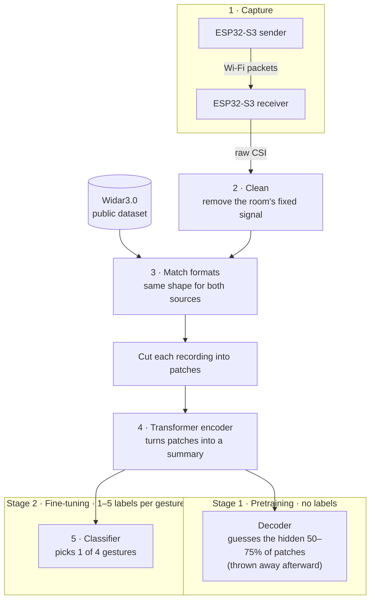

# Wi-Fi Gestures Through Walls — Proposal v2

WAT.ai project · 4-month or 8-month version · 2 TPMs, 8+ core members

## In One Paragraph

When a person moves, Wi-Fi signals change. A cheap receiver can read those changes and tell which hand gesture someone made, with no camera. Models that do this work in the room they were trained in but break in new places. We expect them to break worst when the person is behind a wall. We will build a four-gesture classifier on two ESP32-S3 boards and measure how much setup data from a new location ("calibration") it needs to work through a wall. **The training method is already published. What's new is the through-wall test and the dataset we record.**

---

## 1. The Problem Today

- **How it works:** A Wi-Fi sender and receiver exchange packets constantly. Each packet arrives changed by everything it bounced off, including people. The receiver records these changes as Channel State Information (CSI), a grid of numbers over time and frequency. A gesture leaves a pattern in that grid.
- **Why it's useful:** No camera, works in the dark, cheap hardware.
- **What breaks:** Most of the signal comes from the room itself (walls, furniture), not the person. So models learn the room. In a new room, with a new person, or on new hardware, accuracy drops. Today the fix is to collect and label new data every time.
- **Through walls:** When the person is in the next room, the wall weakens and reshapes the signal. The same gesture gives a different pattern. We want to know how much setup data it takes to fix that.

## 2. Hypothesis

> **A model pretrained on lots of unlabeled Wi-Fi data needs only a little setup data from a new location to recover most of its through-wall accuracy, and less than a model trained from scratch.**

| | |
|---|---|
| **Borrowed** | The training method: masked pretraining (hide parts of a recording, train the model to fill them in). Others have published it. |
| **New** | 1. The through-wall calibration test. 2. A same-room + through-wall ESP32 dataset. |
| **We're wrong if** | Pretrained and from-scratch models need the same amount of setup data, or no amount of setup data closes much of the gap. |

## 3. Architecture



The from-scratch baseline is the same model with Stage 1 skipped.

1. **Capture.** Two ESP32-S3 boards. One sends packets at a fixed rate. The other receives them and logs CSI to a laptop.
2. **Clean.** Remove the room's fixed signal by subtracting each window's average over time. Normalize. Cut recordings into fixed-length windows.
3. **Common format.** Widar3.0 (Intel 5300 cards, 5 GHz, 3 antennas × 30 subcarriers) and ESP32-S3 (2.4 GHz, usually 1 antenna, different subcarrier count and packet rate) look different. Convert both to one shape: amplitude only, a fixed sample rate, a fixed number of frequency bins, one antenna stream at a time.
4. **Tokenize.** Cut each window into small time × frequency patches and turn each patch into a vector.
5. **Encoder.** Small transformer (4–6 layers, width 128–256).
6. **Pretrain (no labels).** Hide 50–75% of patches and train the model to fill them in. Data: Widar3.0 plus unlabeled ESP32 recordings from the development rooms (never the test rooms).
7. **Classify.** A small head on top predicts one of 4 gestures. It is trained on labeled ESP32 recordings from the development rooms.
8. **Baseline.** The same model and steps 4–7, without pretraining ("from scratch").

## 4. Experiment Plan

**Gestures:** 4 from the Widar3.0 set (for example push-pull, sweep, clap, slide). Final pick in week 2.

**Rooms:** two pairs of adjacent rooms. The boards never move.

| Room pair | Used for |
|---|---|
| **A (development)** | Training, tuning, labeled and unlabeled data |
| **B (test)** | Testing only, plus the calibration data in the conditions below |

- **Same-room:** the person is in the room with the boards.
- **Through-wall:** the person is in the room next door.
- In pair B, calibration and test sessions are recorded on different days. Calibration data never appears in a test.

**Volunteers:** 8+ consenting volunteers with signed consent forms. Check with WAT.ai and UW whether ethics review is needed before any recording.

**Calibration conditions** (each run for the pretrained and the from-scratch model where it applies):

| Condition | What the model gets from pair B | How it's used |
|---|---|---|
| None | Nothing | Tested as-is |
| Unlabeled | 1 min or 5 min of raw CSI | Continue pretraining (pretrained model only) |
| Labeled | 1, 3, or 5 examples per gesture | Fine-tune two ways: head only, and whole model |

For labeled conditions, draw the examples 5 times at random and average, since a single draw can be lucky or unlucky.

**Score:** macro-F1, the F1 score for each gesture, averaged. Random guessing scores about 0.25.

**Main number, gap closed:**

```
gap closed = (through-wall with calibration − through-wall with none)
             ÷ (same-room with none − through-wall with none)
```

100% means through-wall now matches same-room.

**Output:** one plot. Macro-F1 on the y-axis, calibration amount on the x-axis, one line each for pretrained and from-scratch, same-room and through-wall.

**Gate before ESP32 experiments:** on Widar3.0, with a held-out room, the pretrained model must beat from-scratch when given few labels (1% and 10%). If not, fix pretraining first.

**Rules:** Never test on data used for training or tuning. Change one thing at a time. Log every run. Report the average over 3+ random seeds.

## 5. Roadmap

**Months 1–4 = Phase 1** (the whole 4-month project). **Months 5–8 = Phase 2** (8-month version only).

### Phase 1 (16 weeks)

| Weeks | Data & Hardware | Modeling | Evaluation | Milestone |
|---|---|---|---|---|
| 1–2 | Flash ESP32s, capture first CSI, consent form | Repo setup, load Widar3.0, plot a sample | Read key papers, define metrics | Everyone onboarded; first live CSI |
| 3–6 | Recorder tool, fixed packet rate, pilot recordings | Cleaning, common format, pretraining, from-scratch baseline | Widar3.0 few-label tests | **Gate 1:** pretrained beats from-scratch on Widar3.0 |
| 7–10 | Record pair A and pair B sessions | Pretrain with pair A ESP32 data, train classifier | Build calibration scripts | **Gate 2:** dataset complete |
| 11–14 | Re-record bad sessions | Run all conditions | Plots, gap-closed numbers | Main result |
| 15–16 | Live demo setup | Clean up and release code | Write report | Demo + report |

### Phase 2 (months 5–8)

- **More places:** ESP32 recordings in 5–10 new rooms, more volunteers, and a second device type (for example another ESP32 model or a Raspberry Pi running Nexmon).
- **More pretraining data:** add public datasets (check licenses first).
- **More labels:** go beyond four gestures.
- **A model improvement:** add the room-invariance training from the original idea (contrastive learning, plus pulling together the same gesture recorded in different rooms). The Phase 1 masked-only model becomes its baseline.
- **Main result:** one calibration curve per kind of change (new room, new person, new device, through-wall). This shows whether through-wall is typical or unusually hard.
- **Stretch:** match Wi-Fi to pose and text so the model can recognize activities it was never given labels for.

## 6. How We Will Manage the Team

### Structure

| Role | Who | Owns |
|---|---|---|
| TPM 1 | Modeling & Evaluation lead | Model, experiments, results, report |
| TPM 2 | Data & Hardware lead | Boards, recordings, consent, room booking, schedule |
| Data & Hardware | 2 members | ESP32 firmware, recording app, data storage |
| Modeling | 3 members | Input pipeline, pretraining, baseline |
| Evaluation | 2 members | Calibration experiments, metrics, plots, report |

### Roles

There are 7 core roles, each with one owner. TPM 2 handles consent, room booking, and volunteer scheduling.

| Subteam | Role | What they own | Skills to recruit for |
|---|---|---|---|
| Modeling | Data pipeline | Widar3.0 and ESP32 loaders, removing the room's fixed signal, converting both to one format | Python, NumPy, basic signal processing |
| Modeling | **Pretraining lead** | The transformer encoder and decoder, masked pretraining runs on GPU | PyTorch, transformers |
| Modeling | Fine-tuning and baseline | From-scratch baseline, gesture classifier, both fine-tuning methods | PyTorch, careful experiment setup |
| Evaluation | Experiment runner | Every setup-data condition, random draws and seeds, logging, gap-closed numbers | Python, basic stats |
| Evaluation | Results and story | Plots, report, final slides, Gate 1 check | Matplotlib, clear writing |
| Data & Hardware | **Firmware** | ESP32-S3 CSI capture, fixed packet rate, timestamps | C, ESP-IDF, embedded |
| Data & Hardware | Recording tool | Laptop recording app, start/stop labels during gestures, data storage, live demo feed | Python, serial ports, simple UI |

**Recruit first:** the pretraining lead and the firmware role are the hardest to fill.

**Members 8 and up** float to the bottleneck: Modeling in weeks 3–6, Data in weeks 7–10. In the last month, they help build the live demo.

### How we work

Meetings stay short. Real work happens in work sessions.

| What | How often | Length | Format |
|---|---|---|---|
| **All-hands** | Weekly | 30 min max | Online. Quick updates and blockers from each subteam. Deep dives move to work sessions. |
| **Subteam sync** | Weekly | 15 min max | Run by the TPM who owns that subteam. |
| **Work sessions** | Weekly | Open-ended | Two locations, Waterloo and Toronto, one led by each TPM (the TPMs are in different cities this term). Join the closer one, or online. |
| **In-person days** | As needed | Longer blocks | For work that needs people in the room: board setup, recording sessions, the demo. Planned 2+ weeks ahead. Recording sessions need 2 members (one runs the software, one guides the volunteer). |

- **2-week sprints:** every task is a GitHub issue with one owner and a due date.
- **Tools:** GitHub for code and issues (every PR reviewed by one other member), Weights & Biases for every training run, a shared drive with limited access for data and consent records.

### Onboarding (weeks 1–2)

- 30-minute explainer on Wi-Fi sensing, plus the glossary below.
- Starter task for everyone: plot one Widar3.0 sample, and capture 10 seconds of CSI on an ESP32.
- New members pair with a returning member where possible.

### Rules

- One owner per milestone. TPMs decide gates at all-hands.
- Every component has a second person who knows it.
- If behind, cut from the bottom: stretch goal → Phase 2 extras → fewer labeled budgets. The main through-wall plot is never cut.

## 7. Risks and Fallbacks

| Risk | Fallback |
|---|---|
| Pretraining barely helps on ESP32 because the hardware differs | Pretrain more on unlabeled pair A ESP32 data. A clear "it doesn't help" is still a result. |
| Through-wall signal too weak for hand gestures | Thinner walls, boards closer to the wall, bigger arm gestures |
| ESP32 packet rate is unstable | Fixed-rate sender, log timestamps, fill in dropped packets |
| Too few volunteers | Team members volunteer (pair A only); more sessions per person |
| Consent or ethics review is slow | Start in week 1; no recording until approved |
| Members leave mid-term | Second person per component; docs live in the repo |

## 8. To Sum Up

- **Problem:** Wi-Fi gesture models break in new places, probably worst through walls.
- **Bet:** pretraining reduces how much setup data it takes to fix that.
- **Test:** 4 gestures, 2 ESP32 boards, same-room vs through-wall, 3 kinds of calibration, one clear plot.
- **New:** the through-wall measurement and the dataset. The training method is borrowed.
- **Team:** 2 TPMs, 3 subteams, 2-week sprints, 2 gates.
- **Outcome:** 4 months gives the through-wall result. 8 months adds curves for every kind of change and a better model.

## Glossary

| Term | Meaning |
|---|---|
| CSI | Channel State Information: how each Wi-Fi packet changed on its way, per frequency |
| Subcarrier | One of the many small frequency slices a Wi-Fi signal is split into |
| ESP32-S3 | A cheap microcontroller board with Wi-Fi that can record CSI |
| Widar3.0 | A public dataset of Wi-Fi CSI recorded while people made hand gestures |
| Transformer | The type of neural network we use (same family as GPT) |
| Pretraining | Training on lots of unlabeled data first, so the model learns what signals look like |
| Masked pretraining | Hiding parts of each recording and training the model to fill them in |
| From scratch | Training with no pretraining; our baseline |
| Calibration | A small amount of data from the new location, used to adapt the model |
| Fine-tuning | Continuing to train a model on a small new dataset |
| Held-out | Data the model never trains on, used only for testing |
| Macro-F1 | Accuracy-like score from 0 to 1, averaged across gestures so each counts equally |
| Gate | A checkpoint we must pass before moving on |
